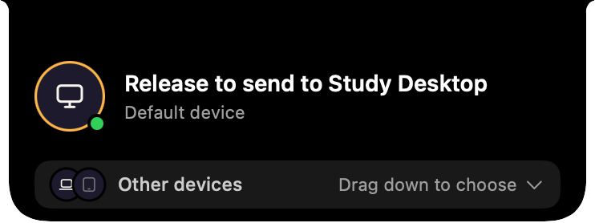
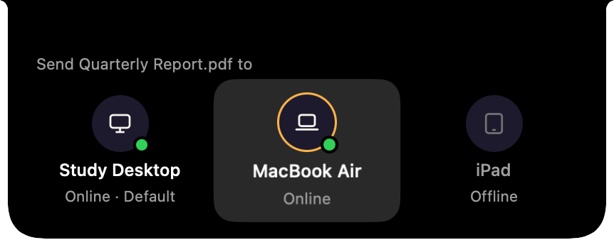
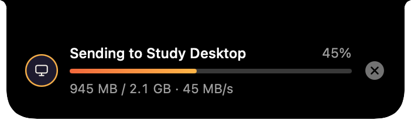
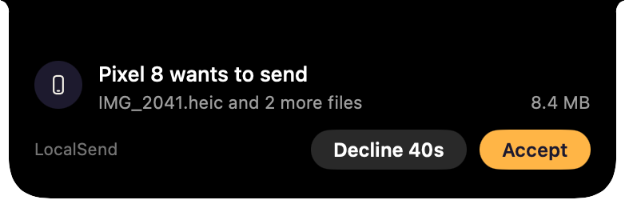

# Wormhole Send

Drop a file on your Mac's notch, or on the island at the top of a Windows screen, and it lands on your other computer. No cloud, no accounts, no "accept?" prompt on the other side.

Wormhole Send is a local-network file transfer app for macOS and Windows. Pair two computers once, and from then on, sending is a single drag. It also exchanges files with [LocalSend](https://localsend.org) on phones and other computers.

<p align="center">
  
</p>

## Features

- **Drag to send.** Start dragging a file and a hint appears at the top of the screen. Drop it there to send it to your default device, or drag down into the list to pick another device.
- **Pair once, then no prompts.** Two devices pair by comparing a 6-digit code. After that, files between them arrive without the receiver confirming anything.
- **Local only.** Devices find each other by multicast on the local network and transfer directly over TLS. Nothing goes through a server.
- **Works with LocalSend.** LocalSend devices (1.18 or later) show up next to your paired ones. Transfers with them work both ways, and the receiver accepts each one.
- **Queues instead of failing.** If the receiver is busy receiving from another device, your send waits its turn and starts automatically.
- **Native on both platforms.** On macOS, a SwiftUI and AppKit app that lives in the notch, or in a floating capsule on an external display. On Windows, a WPF app with a top-of-screen island and a tray menu.
- **English, Chinese and Japanese.** The interface follows the system language, and you can switch it from the menu.

## Screenshots

On macOS:

| Drag down to choose another device | Sending | A LocalSend phone asks to send |
| :---: | :---: | :---: |
|  |  |  |

## How it works

```
 ┌────────────────────┐      ┌────────────────────┐
 │ macOS app (Swift)  │      │ Windows app (WPF)  │
 └─────────┬──────────┘      └─────────┬──────────┘
           │   C ABI + JSON (core-ffi)  │
           └─────────────┬──────────────┘
               ┌─────────┴──────────┐        whs (CLI)
               │  wormhole-core     │◄──────────────────
               │  (Rust)            │
               └─────────┬──────────┘
                         │  LocalSend protocol (HTTPS + multicast)
                    other devices
```

The Rust core handles identity, pairing, trust, discovery, sending, receiving and the receive queue. It is built on the Rust implementation of the [LocalSend protocol](https://github.com/localsend/protocol), so Wormhole Send and LocalSend devices can see each other. Pairing and queueing run over a small control service of its own. The two native apps talk to the core through a C interface with JSON messages ([core-ffi](core-ffi/README.md)).

## Status

Wormhole Send is in early development. Both apps work end to end, but there are no signed releases yet. The [releases](https://github.com/Amethystos325/WormholeSend/releases) have a Windows installer and a macOS disk image, both unsigned, or you build it from source. See the [roadmap](docs/roadmap.md) for what's missing.

| Platform | Requirements |
| --- | --- |
| macOS | macOS 14 or later. Best on a Mac with a notch, and also works on external displays. |
| Windows | Windows 10 or 11 |

## Building

You need [Rust](https://rustup.rs) for every target.

**macOS app**

```bash
cd apps/macos
./scripts/bundle.sh            # builds the core and build/Wormhole Send.app
open "build/Wormhole Send.app"
./scripts/release.sh           # or a disk image, build/WormholeSend-<version>-macos-universal.dmg
```

**Windows app** (needs the [.NET 10 SDK](https://dotnet.microsoft.com/download) and Visual Studio Build Tools with "Desktop development with C++")

```powershell
git config --global core.longpaths true   # a LocalSend dependency has paths over 260 characters
cd apps/windows
dotnet run --project WormholeSend
.\installer\build.ps1                  # or an installer, build\WormholeSend-<version>-setup-x64.exe (needs Inno Setup 6)
```

**Command line** (`whs`, for trying the core without a UI)

```bash
cargo build --release          # target/release/whs
```

The platform READMEs cover signing, demo modes, tests and manual checklists: [macOS](apps/macos/README.md) · [Windows](apps/windows/README.md).

## Quick start with the CLI

```bash
# On the receiving computer
whs receive

# On the sending computer: pair once (both sides show the same 6-digit code), then send
whs devices
whs pair "Study Desktop"
whs send report.pdf designs/
```

See the [CLI guide](docs/cli.md) for every command, LocalSend interop, ports and data locations.

## Repository layout

| Path | What's there |
| --- | --- |
| [`core/`](core) | `wormhole-core`: identity, trust store, discovery, transfers, and the control service for pairing, unpairing and the receive queue |
| [`core-ffi/`](core-ffi) | The core's C interface (`wormhole.dll` / `libwormhole.a` + `include/wormhole.h`) for the native apps |
| [`cli/`](cli) | `whs`, a command-line front end to the core |
| [`apps/macos/`](apps/macos) | The macOS app (SwiftUI + AppKit) |
| [`apps/windows/`](apps/windows) | The Windows app (WPF) and its tests |
| [`assets/`](assets) | Icons and sounds, with the scripts that generate them |
| [`docs/`](docs) | The CLI guide, the roadmap and the README's screenshots |
| [`tools/`](tools) | `translations.py`, which prints every interface string in all three languages |

## Acknowledgements

The transfer layer uses the Rust core of [LocalSend](https://github.com/localsend/localsend) (Apache-2.0). `core/src/identity.rs` and parts of `core/src/send.rs` are adapted from the LocalSend CLI.

## License

Wormhole Send is licensed under the [Apache License 2.0](LICENSE).
